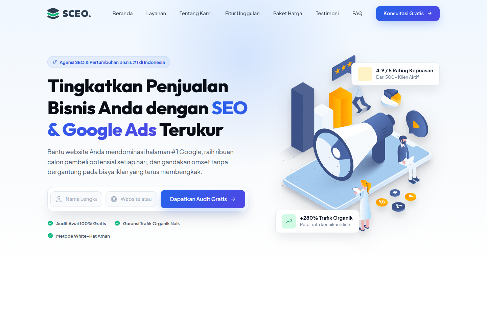
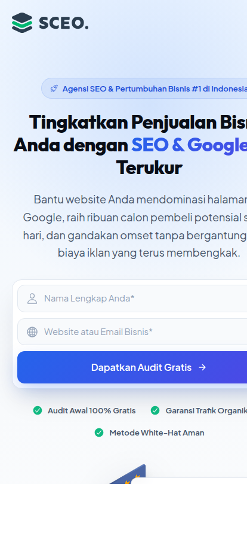

<div align="center">

# 🚀 Website Agensi SEO Indonesia
### *Modern, Professional & High-Converting Digital Marketing Landing Page*

[](https://website-agensi-seo-indonesia.vercel.app/)
[](https://developer.mozilla.org/en-US/docs/Web/HTML)
[](https://developer.mozilla.org/en-US/docs/Web/CSS)
[](https://developer.mozilla.org/en-US/docs/Web/JavaScript)
[](LICENSE)

<br />

### 🌐 **[➥ Klik di Sini untuk Membuka Live Demo di Vercel](https://website-agensi-seo-indonesia.vercel.app/)**

<br />

<p align="center">
  <a href="https://website-agensi-seo-indonesia.vercel.app/" target="_blank" rel="noopener noreferrer">
    
  </a>
</p>

<p align="center">
  <em>Desain antarmuka landing page SCEO Agency dengan estetika modern, glassmorphism, dan tipografi Plus Jakarta Sans.</em>
</p>

</div>

---

## 📸 Preview Tampilan Perangkat

<table>
  <tr>
    <td width="70%" align="center">
      <strong>💻 Tampilan Desktop (Full Responsive)</strong><br><br>
      <a href="https://website-agensi-seo-indonesia.vercel.app/" target="_blank">
        
      </a>
    </td>
    <td width="30%" align="center">
      <strong>📱 Tampilan Mobile</strong><br><br>
      <a href="https://website-agensi-seo-indonesia.vercel.app/" target="_blank">
        
      </a>
    </td>
  </tr>
</table>

---

## 🔗 Tautan Penting

- **Live Demo Vercel:** [https://website-agensi-seo-indonesia.vercel.app/](https://website-agensi-seo-indonesia.vercel.app/)
- **Repositori GitHub:** [https://github.com/fallss/website-agensi-seo-indonesia](https://github.com/fallss/website-agensi-seo-indonesia)

---

## 📖 Tentang Proyek

**Website Agensi SEO Indonesia** adalah landing page profesional dan responsif yang dirancang khusus untuk agensi SEO, konsultan periklanan digital (PPC), dan bisnis pemasaran online di Indonesia.

Situs ini telah dioptimalkan secara menyeluruh dengan:
- **Bahasa Indonesia Baku & Persuasif:** Menggantikan teks lorem ipsum dengan *copywriting* penawaran nilai riil (*value proposition*), bukti sosial, dan ajakan bertindak (*call-to-action*).
- **Desain UI/UX Kelas Atas:** Memadukan tipografi modern (*Plus Jakarta Sans* & *Outfit*), palet warna *royal blue* dan *emerald green*, efek *ambient glow*, serta *glassmorphism* halus.
- **Interaktivitas Tanpa Beban:** FAQ interaktif bergaya accordion, formulir audit dengan umpan balik instan, navigasi mobile yang mulus, dan *floating badge* animasi.

---

## ✨ Fitur-Fitur Utama

1. **Header & Navigasi Responsif:**
   - Efek *sticky blur glassmorphism* saat halaman digulir.
   - Menu drawer mobile yang halus dan ramah sentuhan.

2. **Hero Section Berkonversi Tinggi:**
   - *Headline* persuasif berbasis *data-driven digital marketing*.
   - Formulir audit gratis dengan umpan balik interaktif langsung.
   - *Floating badge* animasi dengan metrik pertumbuhan organik (+280% Trafik & 4.9/5 Rating).

3. **Bar Mitra Kepercayaan (Social Proof):**
   - Menampilkan logo brand dan perusahaan teknologi terkemuka di Indonesia.

4. **Layanan Unggulan (Services):**
   - SEO Lokal & Google Maps
   - SEO E-Commerce & Toko Online
   - Analisis Data & Pelaporan Real-Time
   - Manajemen Google Ads (PPC)

5. **Tentang Kami & Metrik Pencapaian:**
   - Statistik pencapaian: 1.500+ Kata Kunci #1, +350% Kenaikan Trafik, 98,4% Kepuasan Klien, 10+ Tahun Pengalaman.
   - Poin keunggulan *Technical SEO 360°*, Konten Pilar Otoritas Tinggi, dan *Link Building* Media Nasional.

6. **Solusi Pemasaran Terpadu (Features Grid):**
   - 6 kapabilitas pemasaran digital lengkap dengan kartu bergaya modern dan efek hover interaktif.

7. **Tabel Paket Harga Investasi (Pricing):**
   - 3 tingkatan paket transparan: **Starter UMKM (Rp 2,5jt/bln)**, **Growth Bisnis [Paling Populer] (Rp 5,5jt/bln)**, dan **Enterprise (Rp 12jt/bln)**.
   - Dilengkapi checklist fitur komprehensif dalam mata uang Rupiah.

8. **Testimoni Klien Autentik:**
   - Ulasan dengan rating bintang 5, nama pemilik bisnis, posisi, dan foto avatar.

9. **FAQ Accordion Interaktif:**
   - Pertanyaan dan jawaban seputar SEO yang dapat dibuka-tutup dengan transisi rotasi panah yang mulus.

10. **CTA Banner & Footer Komprehensif:**
    - Tombol aksi ganda: Klaim Audit dan Konsultasi Cepat via WhatsApp.
    - Footer multi-kolom dengan informasi kontak lengkap di Jakarta Selatan, navigasi cepat, dan tautan media sosial.

---

## 📁 Struktur Direktori

```text
├── assets/
│   ├── css/
│   │   └── style.css          # Sistem desain modern, variabel CSS, dan responsivitas
│   ├── js/
│   │   └── script.js         # Interaktivitas navbar, accordion, sticky header, form feedback
│   └── images/               # Ilustrasi banner, mockup screenshot, dan aset grafis
│       ├── desktop-preview.png
│       ├── mobile-preview.png
│       ├── hero-banner.png
│       └── logo.svg
├── favicon.svg               # Favicon resmi
├── index.html                # Halaman utama landing page berbahasa Indonesia
├── LICENSE                   # Lisensi MIT
└── README.md                 # Dokumentasi proyek
```

---

## 🚀 Cara Menjalankan Secara Lokal

Anda tidak memerlukan dependensi eksternal atau build tools (seperti Node/Webpack):

1. **Clone repositori ini:**
   ```bash
   git clone https://github.com/fallss/website-agensi-seo-indonesia.git
   ```

2. **Buka folder proyek:**
   ```bash
   cd website-agensi-seo-indonesia
   ```

3. **Jalankan:**
   - Buka file `index.html` langsung di browser Anda, **atau**
   - Gunakan ekstensi *Live Server* di VS Code, **atau**
   - Jalankan local web server via Python:
     ```bash
     python3 -m http.server 8000
     ```
     Lalu buka di browser: `http://localhost:8000`

---

## 🛠️ Teknologi yang Digunakan

- **HTML5** (Semantik, SEO-friendly, Aksesibel)
- **CSS3** (CSS Grid, Flexbox, Custom Properties, Glassmorphism, Micro-animations)
- **Vanilla JavaScript** (Interaksi ringan & cepat tanpa dependensi berat)
- **Ionicons** (Ikon vektor modern)
- **Google Fonts** (*Plus Jakarta Sans* & *Outfit*)

---

## 📄 Lisensi

Didistribusikan di bawah lisensi MIT. Silakan gunakan dan kembangkan untuk proyek bisnis atau portofolio Anda.
